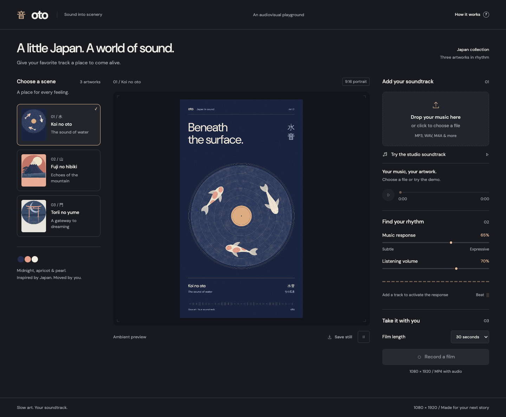
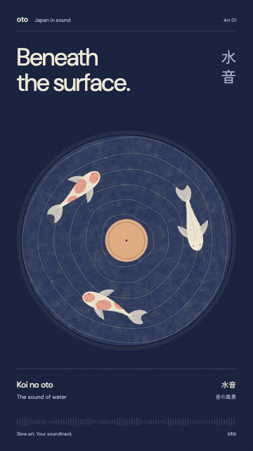
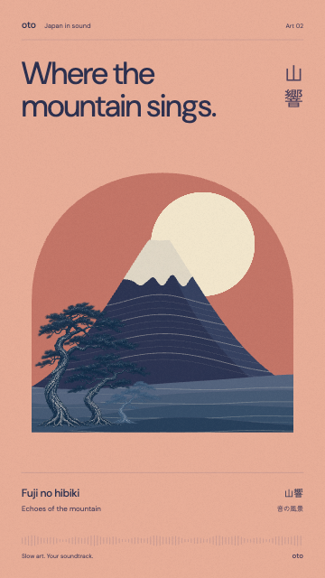
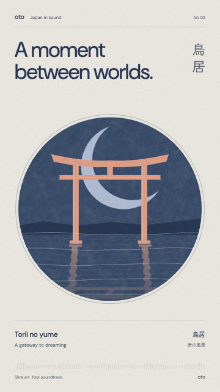

# Oto — Japan in sound

Turn a soundtrack into a living Japanese-inspired print. Oto is a browser-based art studio built with Canvas 2D and the Web Audio API. Upload music, choose a scene, and export a vertical film with your soundtrack.



## Three scenes

| Koi no oto | Fuji no hibiki | Torii no yume |
| --- | --- | --- |
|  |  |  |
| Natural swimming and expanding pond ripples. | Traveling mountain contours and gentle moon drift. | Beat-driven water wakes, reflections and a subtly rotating moon. |

## Run locally

Requires **Node.js 18 or newer**. No dependencies, installation step, API keys, or build step are needed.

```bash
git clone https://github.com/tejj003/oto-japan-in-sound.git
cd oto-japan-in-sound
npm run dev
```

Open **http://localhost:4173**. If that port is in use:

```bash
npm run dev -- --port 4180
```

Python is an alternative:

```bash
python3 -m http.server 4173 --bind 127.0.0.1 --directory dist
```

## Create a film

1. Choose one of the three artworks.
2. Upload an audio file, or try the original studio soundtrack.
3. Press play. The **Beat** indicator confirms detected audio onsets.
4. Adjust music response and listening volume.
5. Save a PNG, or choose a film length and select **Record a film**.

The studio responds to the track loaded into it. Music playing in another tab or application is not captured.

### Exports

- **PNG:** 1080 × 1920.
- **Video:** 1080 × 1920, targeting 30 fps, with audio.
- **Length:** 15, 30, or 60 seconds, capped by the track duration.
- **Format:** MP4 when the browser's recorder supports it; otherwise WebM. The selected format is displayed in the studio. Convert WebM to MP4 before uploading to Instagram.

Recording starts at the beginning of the track. Keep the tab visible until it finishes; hiding the tab stops the recording. Browser support and device performance affect recording format and frame rate.

## How the music response works

The audio graph analyzes the actual playing track. Adaptive bass, melody and treble envelopes keep quieter recordings responsive. Onset detection launches new ripples and contour sweeps, rather than inventing beats on a timer.

Motion is deliberately restrained: wakes travel over roughly three seconds, visual envelopes ease smoothly, and dense beat patterns produce fewer overlapping wakes. Fish use an independent swimming clock. Moon movement is small and bounded, so the artwork keeps its composition.

All audio processing happens locally in the browser. Uploaded tracks are not sent to a server, and there are no analytics or external runtime services.

## Project structure

```text
dist/
  index.html          Studio interface
  app.js              Playback, controls and recording
  reactivity.js       Audio analysis and onset detection
  art.js              Artwork rendering and motion
  tokens.css          Colors, type roles and spacing
  style.css           Studio layout and controls
  typography.css      Latin and Japanese typography
  assets/             Transparent pine illustration and generation prompt
  fonts/              Self-hosted fonts and their licenses
scripts/
  serve.mjs           Dependency-free local server
docs/images/          Screenshots rendered from the working studio
```

Run the JavaScript syntax checks:

```bash
npm run check
```

To host the studio, publish the contents of `dist/` with any static web host. Use HTTPS or localhost for browser media features.

## Credits

- Created by [tejj003](https://github.com/tejj003).
- Built with native JavaScript, Canvas 2D, Web Audio and MediaRecorder, with Codex assistance.
- Typography: **DM Sans** and **Zen Kaku Gothic New**, self-hosted under the bundled SIL Open Font Licenses in `dist/fonts/`.
- The Fuji pine grove was created with image generation and composited into the coded scene. Its final prompt is included in `dist/assets/pine-grove-prompt.md`.
- The built-in demo soundtrack is synthesized locally by the application. No third-party music is included.
